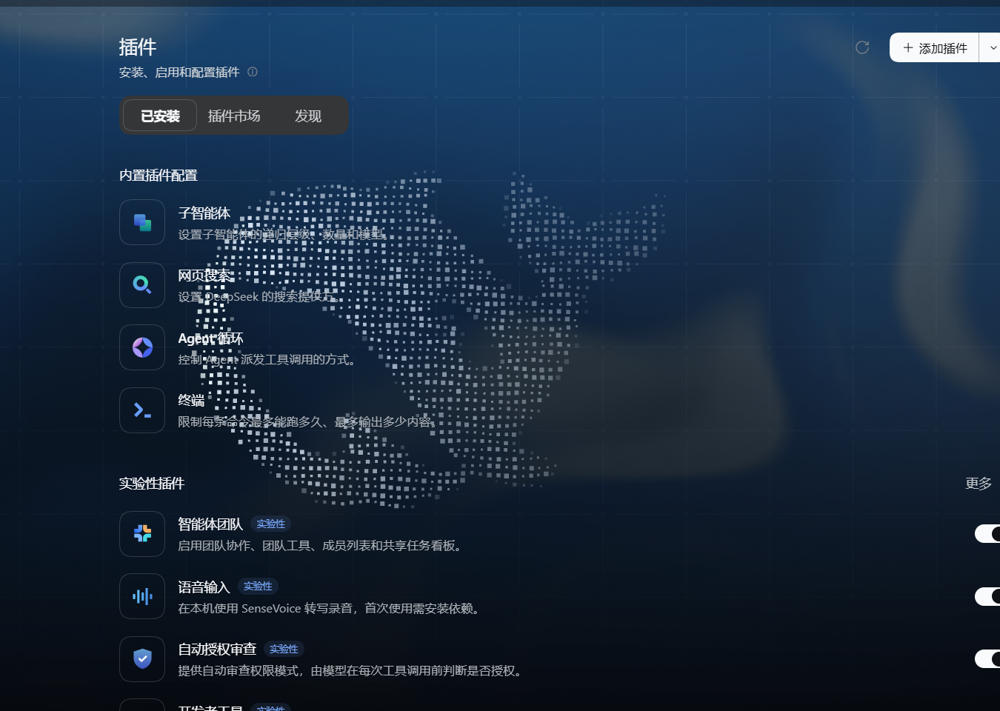
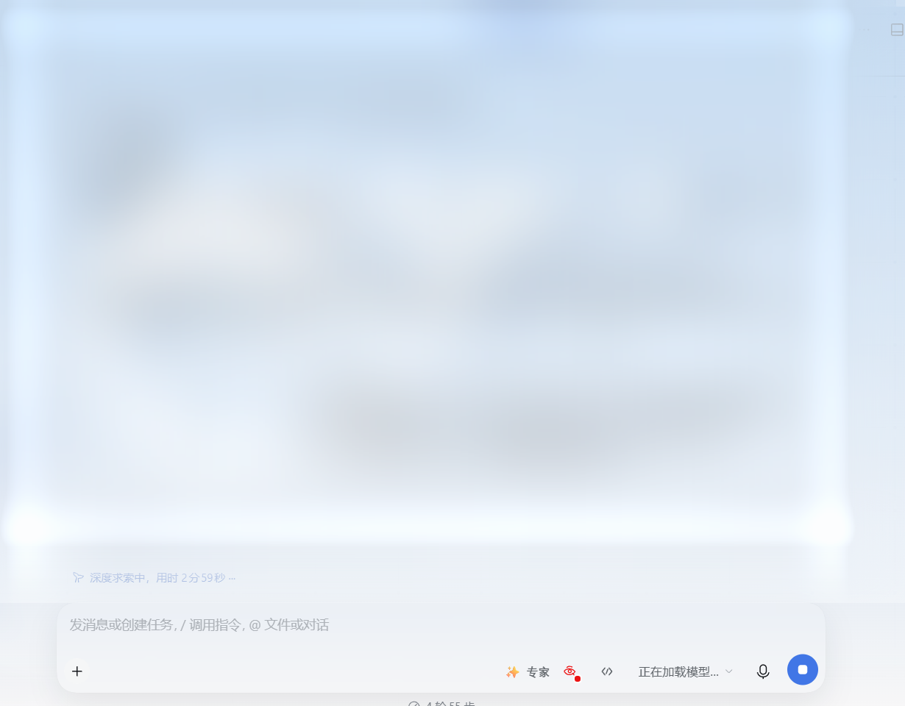

# dsh-official-skin

> 本皮肤灵感来源于最初的 DeepSeek Harness 官网页面。

> 给 **DeepSeek Harness（DSH）** Web 界面换上一套「官网质感」的皮肤：深色是**深蓝宇宙感**（流体极光 + 粒子鲸鱼 + 星座网格），浅色是**官网首页 hero**（蓝色渐变 + 琉璃玻璃）。右上角一键切换，跟随 DSH 设置里的外观偏好。

<p>
  
  
  
</p>

> **兼容范围：** 支持 DSH Web 与 DSH Desktop `^0.2.1-rc.5 || ^0.2.2-rc.1`。DSH Desktop 通过应用内嵌的 Web 界面加载本皮肤。`0.2.1-rc.5` 已有实机验证；`0.2.2-rc.1` 的验证范围见[兼容性](#兼容性)。当前插件版本为 `1.1.8`；本版验证范围见 [兼容性记录](docs/compatibility.md#118-发布核对)，安装方式见[安装](#安装)。

---

## 效果预览

两种主题都由界面右上角的按钮一键切换，动画 300ms 交叉淡入。

| 深色 · 深蓝宇宙感 | 浅色 · 官网 hero + 琉璃玻璃 |
| :---: | :---: |
|  |  |
| 深蓝渐变底 + 流体极光 + 粒子鲸鱼 + 星座网格 | 蓝色 hero 渐变 + 白色粒子鲸鱼 + 玻璃拟态面板 |

---

## 这个插件做了什么

DSH 原生界面是一套规整的灰白 / 深灰配色。这个插件在**不改变任何交互逻辑**的前提下，把它换成两层「有空气感」的视觉：

### 深色主题：深蓝宇宙感

- **底色**：`radial-gradient(165% 115% at 50% -8%, #14385c 0%, #102a45 22%, #0b1a2b 45%, #080f18 70%, #06080c 100%)`，顶部中深蓝、底部近黑，整屏有纵深。
- **流体极光**：WebGL flowmap（复刻 deepseek.com 首页那套流体），压到 `brightness(0.36)` 后用 `screen` 叠加，只留一层缓慢流动的冷蓝 / 琥珀光。
- **粒子鲸鱼**：GLSL 粒子构成的 DeepSeek 鲸鱼 logo，白点发光，**鼠标移动有视差反应**。
- **星座网格**：冷白光点 + 细连线（`rgba(190,214,255)`，线 0.16 / 点 0.26），像一层很淡的星图。

### 浅色主题：官网 hero + 琉璃玻璃

- **底色**：`linear-gradient(180deg, #9cc1e7 0%, rgba(250,250,250,0) 100%), #f9f8f8`，官网首页同款蓝色 hero。
- **粒子鲸鱼**：白色粒子，`normal` 混合，不抢文字。
- **玻璃拟态**：侧边栏、输入卡片、消息气泡、代码块统一 `backdrop-filter: blur() saturate()` + 内侧高光边，做出「一层玻璃」的厚度，而不是一团半透明灰。

### 共同保证

- **不干扰功能面板**：对话框 / 菜单 / 列表 / 模态（`[role=dialog|menu|listbox]`、`[aria-modal]`）保持原生不透明，不会被「穿透」成半透明。
- **切换丝滑**：两层底色交叉淡入 300ms，切换瞬间暂停 WebGL 循环 360ms，避免和合成抢主线程。
- **不泄漏资源**：每次重载都会 `WEBGL_lose_context.loseContext()` 释放旧上下文、停掉旧 RAF、摘掉旧 DOM。

---

## 与 DSH「外观」设置的绑定关系

**这个皮肤不自己做主题判断，它跟随 DSH 自己的主题开关。**

- 打开 **设置 → 通用设置 → 外观**，选「深色 / 浅色」；
- DSH 会把选择写到 `<body data-ds-dark-theme>` 上；
- 插件监听这个属性（`MutationObserver` + 2.5s 兜底对账），把背景层、鲸鱼、极光、玻璃全部切到对应的一套。

也就是说：

| 你在 DSH 里的操作 | 皮肤的反应 |
| --- | --- |
| 外观 → 深色 | 深蓝渐变 + 极光 + 鲸鱼 + 星座 |
| 外观 → 浅色 | 蓝色 hero + 白鲸鱼 + 玻璃面板 |
| 外观 → 跟随系统 | 系统切深浅时，皮肤同步切换 |

右上角那颗按钮是**同一件事的快捷入口**：它调用 DSH 的 `theme` 服务 `setTheme("dark" | "light")`，等价于你去设置里点一次。所以按钮切换后，设置页里的「外观」选项也会跟着变——两者是同一个状态，不存在两套开关。

> 注意：如果底部显示「重新连接中…」，此时客户端拿不到 `theme` 服务，点按钮不会立刻生效（这是宿主断链，不是按钮坏了），重连完成后自动应用。

---

## 安装

### 支持范围

| 项目 | 状态 |
| --- | --- |
| DSH Web | `^0.2.1-rc.5 || ^0.2.2-rc.1`；验证范围见[兼容性](#兼容性) |
| DSH Desktop | 同上，通过桌面应用内嵌的 Web 界面加载 |
| npm 包名 | `dsh-official-skin`；本版 `1.1.8` |
| 插件 Node.js 要求 | `>=20`；运行 DSH `0.2.2-rc.1` CLI 时遵守宿主的 `>=24.9.0` 要求 |

兼容范围同时写在 `package.json` 的 `engines.dsh` 中。低于 `0.2.1-rc.5` 或进入 `0.3.x` 的宿主不在声明范围内。DSH 和 dsh-market 会将预发布版本纳入兼容判断，因此旧版 `1.1.5` 的 `^0.2.1-rc.5` 也允许 `0.2.2-rc.1`；本版显式列出新版本线，避免其他工具按默认 SemVer 规则排除它。

### 方式一：DSH Desktop（推荐）

打开 DSH Desktop 后进入 **插件 → 添加插件**，输入：

```text
dsh-official-skin@1.1.8
```

确认安装后，按应用提示启用插件，并完全退出、重新打开 DSH Desktop。

如果当前桌面版的 npm 安装不可用，也可以改用：

```text
github:kleinklein0824/dsh-official-skin
```

### 方式二：DSH Web 直接安装

终端执行：

```bash
dsh plugin --profile web add "dsh-official-skin@1.1.8"
```

安装完成后刷新 DSH Web，或重新执行 `dsh web`。

### 方式三：通过 dsh-market 插件市场安装

安装并启用 [dsh-market](https://github.com/dsh-market/dsh-market)（npm 包名为 `dshmarket`）：

```bash
dsh plugin --profile web add "dshmarket@latest"
```

打开 **插件市场 → 发现** 或 **主题**，搜索 `dsh-official-skin`，安装或更新后按宿主提示重新加载。

- dsh-market 已将本仓库关联到 npm 包 `dsh-official-skin`，会优先从 npm 安装；仅推送 GitHub 不会更新市场用户安装到的 npm 包。
- 市场卡片预览图由仓库根目录的 `screenshots.json` 声明，依次展示深色、浅色效果。更新图片后等待目录下一次构建，并在市场刷新；不需要重新申请收录。
- 市场短介绍来自 awesome-dsh-plugin 中本插件的 YAML 条目，独立于本 README；更正短介绍需要提交只修改该条目的更新 PR。

也可继续使用 [DSH 皮肤市场](https://github.com/kingOfSoySauce/dsh-skin-market)（`dsh-skin-market`）。该市场与 dsh-market 是两个独立插件，安装来源和更新方式以各自条目为准。

### 安装说明

- **DSH Desktop：** 使用应用内 **插件 → 添加插件** 安装 `dsh-official-skin@1.1.8`，安装、启用和重启均由桌面应用管理。
- **npm：** 已发布到 npm，可通过包名 `dsh-official-skin` 安装；GitHub 安装目标继续保留，作为市场或固定 commit 安装的备用方式。
- **平台：** 包内声明为 `dsh.client.platform = "web"`，DSH Desktop 使用同一套内嵌 Web 客户端加载皮肤，因此 Web 与 Desktop 共用客户端实现。

### 本地开发

仅在调试源码时使用：

```bash
cd ~/.dsh/profiles/web
pnpm add link:"<本仓库的绝对路径>"
```

再把包名加进 profile 的 `package.json`：

```json
{
  "dsh": {
    "profile": {
      "bundles": ["...", "dsh-official-skin"]
    }
  }
}
```

重启 DSH 生效。

### 卸载

```bash
dsh plugin --profile web remove "dsh-official-skin"
```

---

## 目录结构

```
dsh-official-skin/
├─ package.json          # 插件清单：dsh.bundle.patch / dsh.client.platform = web
├─ cordis.patch.yml      # 往宿主 cordis 树 insert 一行（id: official-skin）
├─ lib/
│  ├─ index.js           # 宿主半边：只做静态审计，绝不抛错
│  └─ client.js          # 皮肤本体：CSS + 极光/鲸鱼/星座 WebGL + 主题切换
├─ docs/
│  ├─ preview-dark.png
│  └─ preview-light.png
├─ screenshots.json      # dsh-market 展示的深浅色预览图清单
├─ README.md
├─ CHANGELOG.md          # 版本变更记录（语义化版本）
├─ LICENSE
└─ .gitignore
```

它是标准的 DSH 插件结构：`dsh.bundle.patch` 让宿主把 `cordis.patch.yml` 插进 cordis 树；`dsh.client.platform = web` 让 `lib/client.js` 被 `dsh-client-modules` 扫出来、编进 `window.__DSH_BOOT__`，在页面加载时一次性注入。

### 分层结构

```
#dsh-ds-bg  (position:fixed; inset:0; z-index:-1)
├─ #dsh-ds-bg-light        蓝色 hero 渐变        ← opacity 由 .dsh-ds-dark 切换
├─ #dsh-ds-bg-dark         深蓝 radial 渐变      ← opacity 由 .dsh-ds-dark 切换
├─ #dsh-ds-aurora          WebGL 流体极光（canvas）
├─ #dsh-ds-constellation   星座网格（canvas）
└─ #dsh-ds-whale           粒子鲸鱼（canvas, screen 混合）
```

主题切换只改两层 `opacity` 和三个 canvas 的显示状态，**不重建 DOM、不重新编译着色器**。

---

## 调参

想改视觉不用读完整份代码，参数都集中在 `lib/client.js`：

| 想改什么 | 搜什么 | 默认值 |
| --- | --- | --- |
| 深色底色 | `dsh-ds-bg-dark` 的 `radial-gradient` | `#14385c → #06080c` |
| 极光强度 | `#dsh-ds-aurora` 的 `filter` | `brightness(0.36) saturate(1.45)`（>0.4 会发灰） |
| 星座亮度 | `DARK_CONSTELLATION` / `LIGHT_CONSTELLATION` | 线 0.16 / 点 0.26 |
| 鲸鱼透明度 | `whaleLayer.style.opacity` | 深色 1、浅色 0.72 |
| 切换速度 | `transition: opacity .3s`（四处）、`dsAnimPauseUntil` | 300ms / 360ms |
| 玻璃强度 | `body:not([data-ds-dark-theme])` 下的 `rgba(255,255,255,…)` | 0.18 ~ 0.20 |

改完 `lib/client.js` 需要**重启 DSH 应用**（关闭后重新打开）：客户端代码是页面加载时注入的，桌面端按 Ctrl+R / F5 不会重新 import（实测无效）。

---

## 兼容性

- 声明范围：DSH Web / Desktop `^0.2.1-rc.5 || ^0.2.2-rc.1`。`0.2.1-rc.5` 已有实机验证，Desktop 使用同一套内嵌 Web 客户端。
- `0.2.2-rc.1`：已核对宿主兼容检查、模块加载器、主题服务、主题属性和按钮插槽；并在 Chromium 夹具中检查加载、深浅色切换和重复加载。这不等同于完整 DSH Web / Desktop 场景回归，升级后仍应检查会话切换、输入框与其他插件面板。
- 当前版本及具体证据见 [兼容性核对记录](docs/compatibility.md)。
- 需要 **WebGL2**（极光与鲸鱼）；不可用时自动降级为纯 CSS 背景，界面仍可用。
- 主题判断与主要定位优先使用 `[data-ds-dark-theme]`、`[data-slot]` 等属性；部分视觉修补仍使用宿主的哈希类名，因此宿主升级后仍需检查实际显示效果。

---

## 常见问题

**Q：点了右上角按钮没反应？**
底部出现「重新连接中…」时，客户端拿不到 `theme` 服务，点击会被静默丢弃；等连接恢复后再点即可。

**Q：改了 `client.js` 但界面没变？**
客户端 bundle 是页面加载时注入的，必须重载页面 / 重启应用，`set_plugin` 启停不会重新 import。

**Q：控制台报 `Too many active WebGL contexts`？**
Chromium 对同时存在的 WebGL 上下文有上限。本插件已在重载时主动释放旧上下文；若还出现，通常是别的插件也在开 GL 上下文。

---

## 性能与稳定性

- Windows 标题栏探测元素使用深浅色分别指定的高对比符号色；两个主题的顶部填充令牌统一为透明，减少顶部独立色带。当前发布检查覆盖隔离 DOM 中的样式规则与令牌调用，尚未完成原生 Windows 标题栏实测。
- 切换会话和工作区时优先保证首帧显示，避免不透明底板短暂盖住背景。
- 新建会话时统一主题按钮的显示来源，避免右上角出现两个按钮；插槽注册失败时保留 DOM 按钮兜底。
- 会话或模块切换时短暂停止背景绘制，600ms 后自动恢复；入场结束后撤销临时图层提示，减少持续合成开销。
- 深度界面扫描分帧执行，聊天流式输出时不会因反复全量扫描而明显卡顿。
- 弹窗打开时暂停背景动画，关闭后自动恢复。
- 输入框玻璃模糊移到独立图层，鼠标停在发送键上时不再持续闪烁。
- 插件重载时会清理旧实例，避免动画叠层和资源泄漏。

---

## 版本记录

最新版本、修复内容和历史变更见 [CHANGELOG.md](./CHANGELOG.md)。

---

## Roadmap

- [ ] 主题跟随系统时更平滑的过渡（目前是 300ms 直切）
- [ ] 可配置的极光强度 / 粒子密度（配置文件或设置页项）
- [ ] 更多配色预设（青绿、紫罗兰）

---

## 致谢

深色极光与鲸鱼的着色器思路参考 deepseek.com 首页的流体与粒子效果，并由本项目重新移植、压暗、适配 DSH 的层级与主题体系。

## License

[MIT](LICENSE) © 2026 Klein

本项目是非官方社区插件，与 DeepSeek 官方无隶属或背书关系。DeepSeek 名称、鲸鱼图形及相关品牌素材的权利归其各自权利人所有，不在本项目的 MIT 授权范围内。详见 [NOTICE.md](NOTICE.md)。

## 作者

- 姓名：Klein
